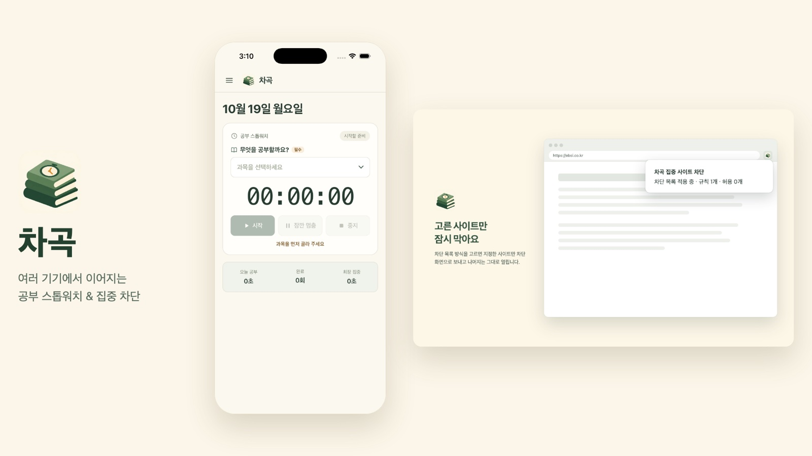
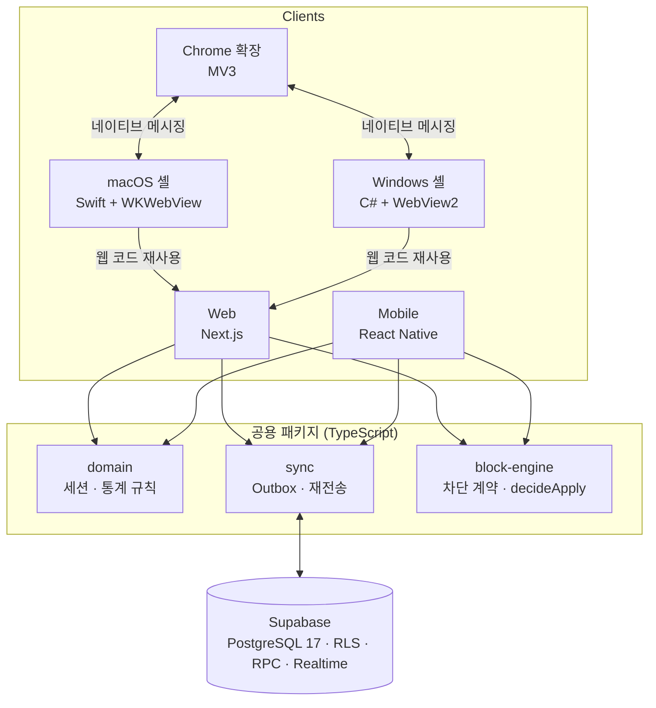
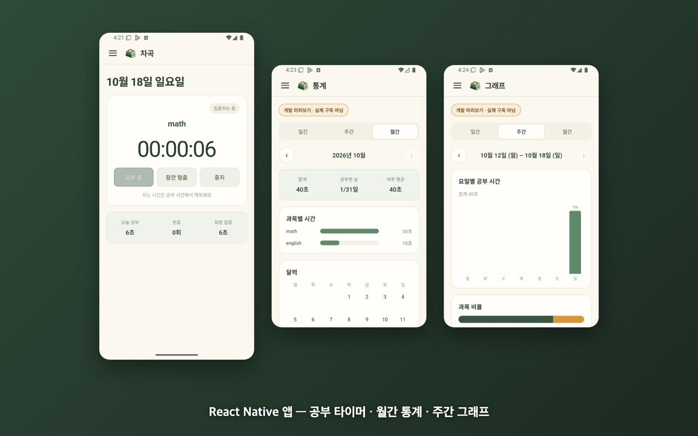
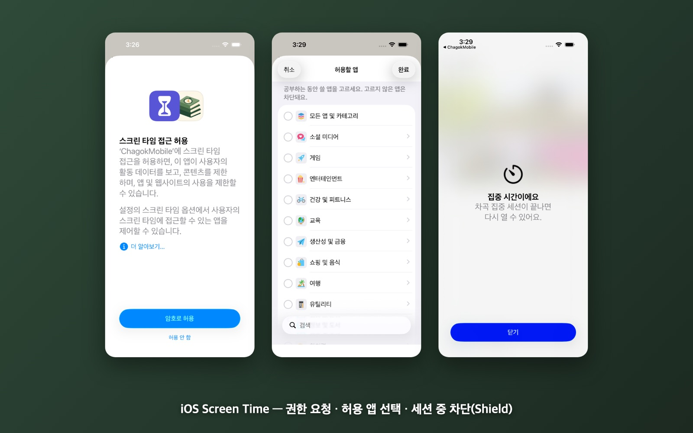
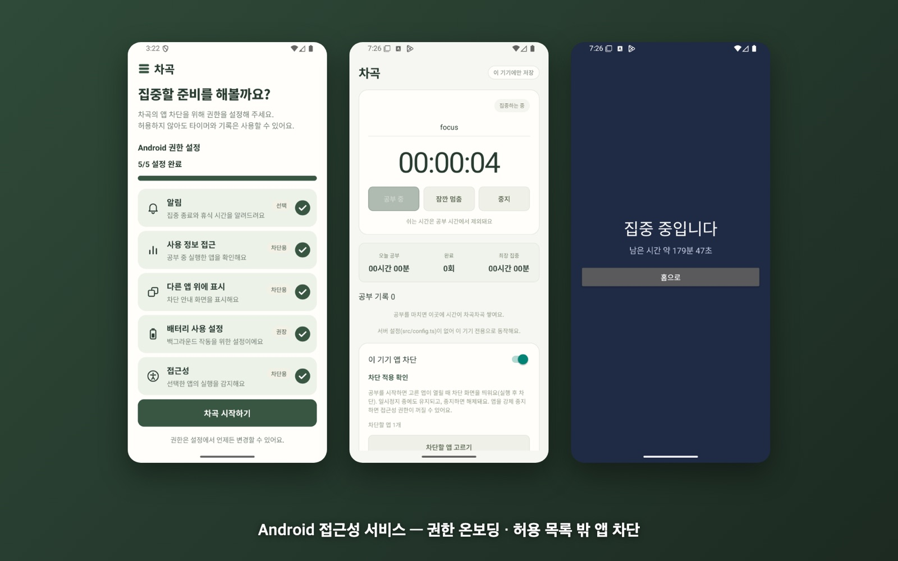
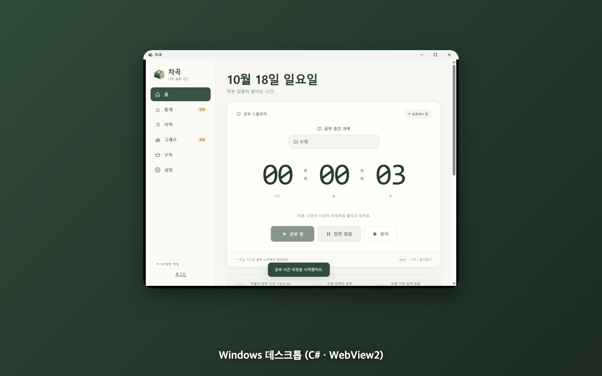
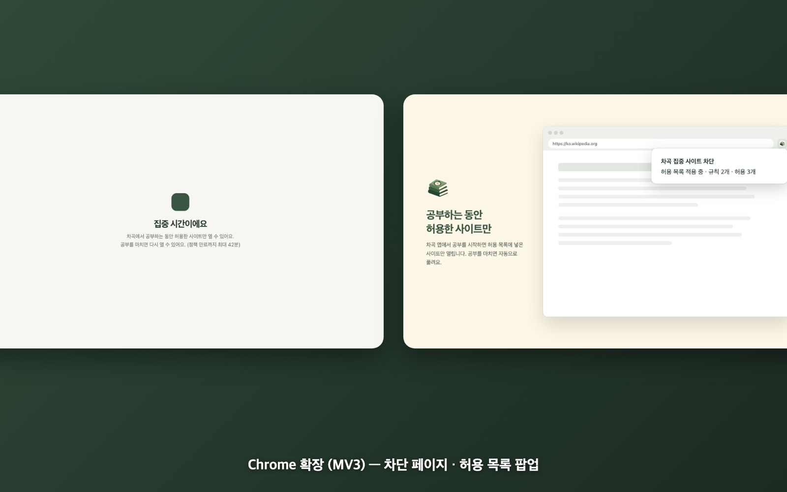

# 차곡 (Chagok)

공부 시간을 재고, 공부하는 동안 방해되는 앱과 사이트를 막아 주는 공부 스톱워치입니다.
웹, 모바일, 데스크톱, 브라우저 확장이 하나의 백엔드와 공용 TypeScript 패키지를 공유합니다.

**[라이브 데모](https://chagok-murex.vercel.app)** · **[포트폴리오 상세](https://simhyeoncheol.vercel.app/portfolio-details-chagok.html)**

> 이 저장소는 프로젝트 소개용입니다. 소스 코드는 비공개 저장소에서 관리하며, 면접 등에서 요청하시면 열람 권한을 드립니다.

| 항목 | 내용 |
|---|---|
| 기간 | 2026.10 ~ 진행 중 |
| 역할 | 1인 개발 (기획, 설계, 전 플랫폼 구현, 테스트) |
| 플랫폼 | Web · Android · iOS · macOS · Windows · Chrome 확장 |

## 기술 스택

| 영역 | 기술 |
|---|---|
| 웹 | Next.js 16 (정적 export), React 19, Vercel |
| 모바일 | React Native 0.88 (iOS · Android 공용 코드), Kotlin, Swift |
| 데스크톱 | Swift + WKWebView (macOS), C# .NET 8 + WebView2 (Windows) |
| 브라우저 확장 | Chrome Manifest V3, declarativeNetRequest, 네이티브 메시징 |
| 백엔드 | Supabase (PostgreSQL 17, RLS, RPC, Realtime) |
| 공용 | TypeScript pnpm 모노레포 (도메인 · 동기화 · 차단 규칙 패키지) |
| 테스트 | Vitest, PGlite / embedded PostgreSQL 17, XCTest, JUnit, GitHub Actions |

## 기술 선택 이유

설계 단계에서 대안을 비교하고 결정 기록(ADR)으로 남긴 내용을 요약했습니다.

### 백엔드: NestJS 서버 대신 Supabase
| 검토한 선택지 | 판단 |
|---|---|
| NestJS + PostgreSQL + WebSocket (초기 기획안) | API 서버, 실시간 서버, 인증을 직접 만들고 운영해야 함 |
| **Supabase (채택)** | PostgreSQL 함수(RPC) · RLS · Realtime · Auth를 한 번에 제공 |

- 핵심 요구는 "활성 세션은 1개", "같은 명령은 한 번만 반영" 같은 **데이터 정합성**이었습니다. 이 검증이 한 트랜잭션 안에서 끝나야 해서, API 서버 대신 **DB 함수 안에 행 잠금과 버전 검사**를 두는 쪽이 더 단순하고 안전하다고 판단했습니다.
- 계정별 접근 제한은 서비스 계층이 아니라 **RLS와 RPC 내부의 `auth.uid()` 검사**로 DB에서 강제합니다.
- 대가: 로직이 SQL에 있으므로 SQL 테스트가 필수가 됐고, PGlite(단일 연결)와 embedded PostgreSQL 17(동시 연결)로 테스트 환경을 만들었습니다. Realtime은 전달이 보장되지 않아, 알림 유실을 전제로 재연결 · 60초 주기 · 화면 복귀 시 재조회하도록 했습니다.

### 데스크톱: Electron → OS별 얇은 네이티브 셸
| 검토한 선택지 | 장점 | 단점 |
|---|---|---|
| Electron (처음 잠정 채택) | TypeScript만으로 개발, 웹과 같은 Chromium | 앱 크기 200MB 이상, 상주 메모리 큼 |
| Tauri v2 | 시스템 웹뷰라 가벼움 | Rust가 네 번째 언어로 추가됨. macOS 시스템 확장 · 서명은 결국 Swift 브리지가 필요 |
| SwiftUI / WinUI 네이티브 UI | OS 통합이 가장 확실 | UI를 두 번 만들어야 하고 웹 코드를 재사용 못 함 |
| **Swift + WKWebView / C# + WebView2 (채택)** | 웹 화면 그대로 재사용, 차단 엔진과 같은 언어 | 셸 두 개 유지 (둘 다 얇은 컨테이너) |

- 공부하는 동안 **하루 종일 켜 두는 앱**이라 크기와 메모리가 중요했습니다. Electron으로 먼저 만들었다가 "너무 무겁다"는 판단으로 교체해 macOS 약 2.2MB, Windows 약 4.2MB가 됐습니다.
- 차단 엔진이 이미 Swift(macOS)와 C#(Windows)라서, 셸도 같은 언어로 만들면 **자식 프로세스 · IPC 없이 직접 호출**할 수 있습니다.
- 셸과 차단 에이전트 사이는 좁은 JSON 명령(apply / clear / status)만 오가도록 계약을 분리해 두어, 셸을 바꿔도 차단 로직은 그대로 쓸 수 있게 했습니다. 실제로 Electron → 네이티브 셸 교체 때 이 계약 덕분에 변경 범위가 셸에 한정됐습니다.

### 사이트 차단: 브라우저 확장 + 앱 허용 목록
| 검토한 선택지 | 판단 |
|---|---|
| hosts 파일 · 로컬 프록시 · 방화벽 | VPN 충돌, 해제 실패 시 인터넷 자체가 끊길 위험 |
| macOS Network Extension 콘텐츠 필터 | 시스템 전체 차단이 가능하지만 유료 개발자 계정 · 별도 권한 · 공증이 필요해 당장 검증 불가 |
| **Chrome MV3 확장 + 앱 허용 목록 (채택)** | 설치 · 해제가 안전하고, 허용하지 않은 브라우저는 앱 차단으로 실행 자체를 막음 |

- 실패해도 사용자의 인터넷을 망가뜨리지 않는 방식을 1순위로 두었습니다. 콘텐츠 필터는 코드 골격만 두고, 개발자 계정이 준비되면 Safari까지 넓히는 다음 단계로 남겼습니다.

### 모바일: React Native + 플랫폼별 네이티브 모듈
- 세션 규칙 · 동기화 · 차단 판정 로직을 TypeScript 공용 패키지로 만들어 **웹과 모바일이 같은 코드를 공유**합니다. iOS와 Android 화면도 한 코드베이스로 만듭니다.
- 반면 차단은 OS API(iOS FamilyControls, Android 접근성 서비스 · Device Owner)에 직접 붙어야 해서, 이 부분만 Swift / Kotlin 네이티브 모듈로 구현하고 공통 `BlockEngine` 계약으로 연결했습니다.

### 웹: Next.js 정적 export
- 기록은 브라우저(IndexedDB)와 Supabase에만 있고 서버에서 렌더링할 데이터가 없어서, SSR 서버 없이 **정적 파일로 export**했습니다. 같은 결과물을 데스크톱 셸이 그대로 로드하고, 웹은 Vercel에 정적 배포합니다.

## 구조

- 모든 클라이언트는 명령을 로컬(IndexedDB / SQLite)에 먼저 기록하고 서버로 재전송합니다(Outbox 패턴).
- 차단은 `BlockEngine` 계약 하나를 iOS(FamilyControls), Android(접근성 서비스 / Device Owner), macOS 에이전트, Windows, Chrome 확장이 각각 구현합니다.
- 데스크톱 앱은 Electron 대신 얇은 네이티브 셸로 만들어 번들 크기를 macOS 약 2.2MB, Windows 약 4.2MB로 줄였습니다.

## 화면

| | |
|---|---|
|  React Native 앱 (타이머, 월간 통계, 주간 그래프) |  iOS (Screen Time 권한, 공부 중 앱 차단) |
|  Android (접근성 서비스로 앱 차단) |  Windows 데스크톱 앱 (C#, WebView2) |
|  Chrome 확장 (차단 페이지, 허용 목록) | |

## 기술적 과제와 해결

### 1. 다중 기기 세션의 동시성 제어와 멱등 처리
- **문제:** 두 기기에서 동시에 START하면 애플리케이션 레벨 check-then-insert로는 활성 세션이 2개 생길 수 있고, 오프라인 재전송으로 같은 명령이 여러 번 도착합니다.
- **해결:** RPC 안에서 `profiles` 행을 `SELECT … FOR UPDATE`로 잠가 직렬화하고, 활성 세션에 부분 유니크 인덱스를 걸었습니다. 명령은 `commandId`(PK)로 멱등 처리하고, 상태 변경은 `expectedVersion` 기반 낙관적 동시성 제어로 충돌을 감지합니다.
- **결과:** 실제 PostgreSQL 17 동시 연결 테스트에서 START 12건 → 활성 세션 1건, 동일 `commandId` 8건 → 이벤트 1건.

### 2. iOS Screen Time 차단의 자가 만료
- **문제:** 앱이 종료돼도 세션이 끝나면 차단이 반드시 풀려야 합니다.
- **해결:** 해제를 OS 스케줄러(DeviceActivity)에 위임하는 fail-safe 설계. 15분 미만 구간 거부(`intervalTooShort`)는 16분 구간 + `warningTime` 콜백으로 우회하고, 만료 예약이 실패하면 방금 적용한 Shield를 즉시 롤백합니다.
- **결과:** 15분 경계 · 자정 경계 · 1주 초과 케이스 포함 단위 테스트 21개.

### 3. Android 차단: 접근성 서비스와 Device Owner 이중 구현
- **문제:** 접근성 서비스는 앱 실행 후 화면을 가리는 사후 차단이라 타이밍 경쟁이 있었습니다(로그로 차단 화면 24.715s, HOME 24.868s 역전 확인).
- **해결:** 권한 수준별로 두 엔진을 같은 `BlockEngine` 계약 뒤에 두고, Device Owner 엔진은 `setPackagesSuspended` 후 OS 상태를 재조회해 active / partial / failed를 판정합니다.
- **결과:** 에뮬레이터(API 36) 15개 시나리오, JVM 단위 테스트 11개.

### 4. macOS 차단 에이전트의 집행 검증
- **문제:** `NSRunningApplication.terminate()`의 반환값은 실제 종료를 보장하지 않습니다.
- **해결:** `kill(pid, 0)`과 `isTerminated`로 프로세스 소멸을 확인한 경우만 성공으로 집계하고, 알림 누락은 1초 주기 스캔으로 보완했습니다.
- **결과:** 종료 확인 233~1972ms, 만료 후 해제 8ms, 비대상 프로세스 95개 PID 불변, swift test 33개.

### 5. Chrome MV3 확장의 fail-safe 만료
- **문제:** 호스트 앱과 연결이 끊겨도 차단이 무기한 남으면 안 되고, MV3 서비스 워커는 수명이 짧습니다.
- **해결:** `chrome.alarms` 30초 주기 동기화, 캐시된 정책은 `expiresAt`까지만 유지, 적용 후 `getDynamicRules()`로 실제 반영을 재확인합니다.

### 6. 타임존 · DST 인지 통계
- 이벤트 구간만 저장하고 자정 경계에서 날짜별로 분할, 겹치는 구간은 합집합으로 계산합니다. 서버 집계와 클라이언트 계산을 Asia/Seoul, America/New_York 기준으로 교차 검증했습니다.

## 테스트

- Vitest + PGlite(PostgreSQL 17)로 도메인, RLS / RPC 권한 경계, 동시성 테스트 약 200개
- Windows CI 단위 테스트 278개, 데스크톱 기능 테스트 94개
- 모든 플랫폼을 에뮬레이터 · 시뮬레이터 · CI에서 검증했으며, 실기기 테스트는 진행 예정입니다.

## 연락처

- 포트폴리오: https://simhyeoncheol.vercel.app
- 이메일: simhyeoncheol3@gmail.com
